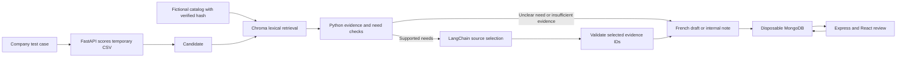

# Next-BH architecture and implementation inventory

Reviewed 24 November 2026, Africa/Tunis. The default-branch baseline is [`7173a27`](https://github.com/naderite/Next-BH/commit/7173a27ef38bf462f58adb8c09d3b255093a1d47). The audit covers the visible Next-BH and upstream branch history, the recovered dashboard archive, the original insurer files, and the local academic plan. [Jira reconciliation](https://maiteai.atlassian.net/browse/BH-20)

## Delivery record

| Work | Verified state | Evidence |
| --- | --- | --- |
| Original Next Deal prototype | The 2025 source implements a Python sales worker, a six-route opportunity API, French drafting and RAG, intent analysis, MongoDB state, and a Gmail receiver. Historical dashboard code has review, history, and analytics screens. Full legacy operation was outside the pilot acceptance checks. | [Original baseline](https://github.com/naderite/Next-BH/commit/49167ad39c819eed2ecea271d731c9180796ef7a), [integration notes](../INTEGRATION_SUMMARY.md), [dashboard provenance](DASHBOARD_SOURCE.md) |
| Historical data engineering | An older FastAPI module builds and previews a SQL Server table for PP data. Another historical revision contains a ranked PM CSV whose lineage is unverified. The current API reads prepared scores from CSV and applies ranking or threshold rules. The historical table builder has no CatBoost model fit or load. | [Historical builder](https://github.com/naderite/Next-BH/blob/f7130df/pipeline/catboost_app.py), [current API](../api_datasets/app.py) |
| Local source archive and data review | The earlier review compared the two distinct archive versions, profiled the joins and source exceptions, smoke-tested standalone recommenders, and produced a SQLite research package with row provenance, data dictionary, report, and checksum validation. These artifacts are in the local `data-review/` workspace alongside the repository. | [Source intake and verification](https://maiteai.atlassian.net/browse/BH-18) |
| Team setup and Wave 1 | Jira access and workflow, deterministic company recommendation contract, pending draft creation, integrated demo, and clean-checkout runbook. Done. | [BH-1](https://maiteai.atlassian.net/browse/BH-1), [BH-2](https://maiteai.atlassian.net/browse/BH-2), [demo](RECOMMENDATION_DEMO.md) |
| Wave 2 | Historical dashboard export, approval and rejection, reviewer and server timestamp persisted atomically, repeat decision rejected, and reproducible CI. Done. | [BH-7](https://maiteai.atlassian.net/browse/BH-7), [verification](DRAFT_REVIEW_DEMO.md) |
| Wave 3 | Company candidate selection, Chroma retrieval, grounded drafts, dashboard ingestion, and 24/24 deterministic outcomes are merged. Live Gemma and scored human evaluation are pending. | [BH-12](https://maiteai.atlassian.net/browse/BH-12), [BH-16](https://maiteai.atlassian.net/browse/BH-16), [pilot evidence](STAGING_PILOT.md#pilot-results) |
| Checkout and project reporting | Submodule metadata and action runtime fixes are merged. French progress record and report prompt are merged. The standalone Gemma explainer is in review. | [BH-17](https://maiteai.atlassian.net/browse/BH-17), [BH-19](https://maiteai.atlassian.net/browse/BH-19), [PR #15](https://github.com/naderite/Next-BH/pull/15) |
| DVC intake | The three original workbooks are versioned and profiled locally. A fresh checkout restored the tracked inputs from the local DVC store and reproduced the same report. CI passed and the PR is in review. | [BH-18](https://maiteai.atlassian.net/browse/BH-18), [PR #16 and setup](https://github.com/naderite/Next-BH/pull/16) |
| Academic architecture | The reviewed design proposes a housing-insurance workflow for individuals, a persistent LangGraph workflow, simulator-based MaskablePPO, and two MLOps pipelines. Implementation and acceptance evidence for the full design remain open. | [Architecture and pilot scope](AVANCEMENT.md#partie-de-larchitecture-couverte), [Jira inventory](https://maiteai.atlassian.net/browse/BH-20) |

## Data lineage

| Data | Origin and use |
| --- | --- |
| Original insurer workbooks | Three supplied workbooks covering PP individuals, PM companies, contracts, guarantees, claims, the product hierarchy, guarantee descriptions, and target profiles. The original and v2 copies have identical workbook bytes. The verified snapshot contains 366,966 rows across eight sheets, including 44,061 customer records. |
| SQLite research package | The earlier local package at `data-review/organized-data/insurance_data.sqlite` preserves raw rows, original workbook bytes, relationship views, and source exceptions. It is a derived artifact with source provenance. The app and Wave 3 launcher do not read it. |
| Real-data recommendation prototypes | The supplied v2 archive contains `insurance_recommender_physique.py` and `insurance_recommender_morale.py`. They read Excel directly, combine TF-IDF text similarity with contract-based collaborative filtering using truncated SVD, and returned recommendations on the recorded sample checks. The PP prototype mixes customer categories in its contract matrix. Both have cold-start and identity-quality issues and lack held-out evaluation. The pilot does not import them. |
| Legacy serving inputs | The FastAPI endpoints use six prepared files for PP/PM recommendations, invoices, and renewals. The active checkout lacks those files. Saved JSON outputs are examples. The historical API's identity enrichment generates contact and display fields over the input profile. |
| Wave 3 fixtures | Checked-in fictional company cases and fictional catalog passages, introduced together in [`0a8c2dd`](https://github.com/naderite/Next-BH/commit/0a8c2dd9f75882fe24fddb3914442a5e5232e135). They were authored for controlled scenarios. No source sampling, augmentation, or anonymization of the original workbooks is part of this path. The adapter writes a two-row temporary CSV per case. |
| DVC inputs and output | `source_inputs/workbooks.dvc` pins the original workbook snapshot. `dvc.yaml` and `dvc.lock` define and record the read-only quality stage. `data/source-quality.json` contains aggregate counts and fingerprints. The data, report, cache, and machine-local filesystem store are local. GitHub carries code, docs, and DVC metadata. |

The aggregate validation found 92 cached Excel errors, 1,068 contracts with no matching customer, 210 guarantee lines with no matching contract, and 3,091 repeated contract/guarantee groups. A usable projection needs reviewed product IDs and eligibility, a declared date for time-based features, retained unknowns, and separate claim and coverage aggregates to prevent join duplication. The supplied materials provide no dated recommendation-exposure and customer-response trajectories for measuring policy rewards. The source data can inform portfolio and profile distributions for a simulator. [DVC evidence](https://github.com/naderite/Next-BH/pull/16)

The fictional fixtures make the expected recommendation, clarification, and abstention outcomes repeatable without distributing customer records, invoking outbound services, or relying on unresolved real product mappings. A future reviewed source-derived projection is a separate input for the academic data pipeline. [Cases and rubric](STAGING_EVALUATION.md)

## Implemented runtime

- **Original agent.** `agent/app.py` runs the polling loop. `agent/agent.py` implements the `SalesAgent` class and initial and reply flows. Intent helpers combine rules and a classifier fallback. The LLM helper configures Ollama Gemma for generation and Qwen for query and subject helpers. The original RAG tooling accepts external PDF/CSV documents and configures multilingual E5 embeddings. Gmail and MongoDB helpers exist in the original prototype. [Agent](../agent/agent.py), [model configuration](../agent/config.py), [RAG code](../agent/rag_model/rag.py)
- **Isolated pilot.** The launcher invokes the real FastAPI route, embeds Chroma in process using deterministic lexical vectors, filters by the selected product, and checks that excerpts support the stated needs. The model, when used, selects evidence IDs. Python validates those IDs and constructs the message. Missing needs or evidence produce review notes. The dashboard persists one decision with the reviewer and UTC timestamp. Gmail, customer delivery, Kafka, and the original reply loop are outside this launcher. [Input adapter](../scripts/staging_inputs.py), [grounding](../agent/utils/grounded_recommendation.py), [launcher](../scripts/run_staging_recommendations.py)
- **Configuration.** Python 3.12 and `scripts/staging-requirements.txt` cover the isolated Python stack. Node 22+, npm, and Docker run the pinned historical dashboard and disposable MongoDB. Live mode requires local Ollama, `gemma3n:e4b`, an explicit model digest, an approved catalog hash, and an authorized reviewer. GitHub Actions runs deterministic model responses with real Chroma, MongoDB, and Chromium. The root Compose definitions provide separate legacy SQL Server, Kafka/Connect, MongoDB, Chroma and OpenTelemetry/Zipkin services. Their presence does not establish deployment or application event integration. [Setup](STAGING_SETUP.md), [staging workflow](../.github/workflows/staging-pilot.yml), [legacy Compose](../docker-compose.yaml)

## Academic design and completion gaps

- **Agentic AI.** The Python `SalesAgent`, tool calls, LangChain drafting, retrieval, and dashboard review already exist. The academic design adds a persistent LangGraph state machine around profile/context, intent, policy selection, retrieval, drafting, and review. The intended graph pauses for review and resumes from stored state after the exact draft revision is approved. No peer-agent team or persistent LangGraph runtime was found in the reviewed project sources. [LangGraph orchestration](https://docs.langchain.com/oss/python/langgraph/overview)
- **Reinforcement learning.** The academic design calls for MaskablePPO to select the next business action from customer context and observed conversation state. A shared simulator must define valid actions, customer responses, contact costs, episode termination, and rewards. Masks exclude ineligible actions during training, evaluation, and inference. The design calls for five training seeds, held-out simulated episodes, and comparison against rules and random-valid baselines. It requires saved policy weights, a fresh application load, and a recorded policy decision. No simulator, training run, saved policy, or loaded inference was found. The existing recommendation scores and language model outputs are separate components. [MaskablePPO reference](https://sb3-contrib.readthedocs.io/en/master/modules/ppo_mask.html)
- **P1 Data & RAG.** The local workbook DVC stage is the implemented intake component. The pilot independently builds a Chroma index from its fictional catalog. P1 still needs a reviewed source-derived projection, stable product and evidence IDs, approved source passages, and reproducible projection and index manifests linked to the data snapshot. [DVC pull request](https://github.com/naderite/Next-BH/pull/16), [DVC stages](https://doc.dvc.org/command-reference/stage/add)
- **P2 RL Learning and MLOps.** The planned training pipeline consumes a versioned P1 snapshot and simulator configuration, trains and evaluates masked policies, and saves the model and compatible action and observation schemas. MLflow would record input versions, configuration, seeds, metrics and artifacts. A selected model version then needs a pinned runtime reference and load verification. No MLflow tracking runs, registry, or P2 pipeline were found. GitHub Actions currently verifies the pilot, DVC records data lineage locally, and the legacy tracing configuration concerns service telemetry. [MLflow tracking](https://mlflow.org/docs/latest/ml/tracking/), [model registry](https://mlflow.org/docs/latest/model-registry/)
